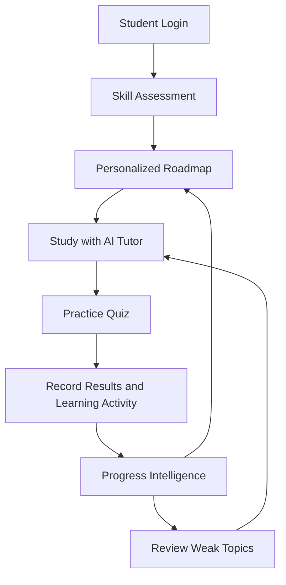

# CampusCompass — AI-Powered Student Learning Assistant

An intelligent, personalized learning platform that helps students assess their skills, build learning roadmaps, practice quizzes, interact with an AI tutor, and track their learning progress through a unified dashboard.

**Built with React, FastAPI, PostgreSQL, and AI-powered multi-agent workflows.**

[](https://react.dev/)
[](https://fastapi.tiangolo.com/)
[](https://www.python.org/)
[](https://www.postgresql.org/)

## Overview

CampusCompass is an AI-powered student mentoring and study assistance platform designed to make personalized learning more structured, measurable, and accessible.

Instead of treating assessment, tutoring, quizzes, and progress tracking as separate activities, CampusCompass connects them into a continuous learning journey.

Students can identify skill gaps, receive personalized recommendations, follow learning roadmaps, practice concepts through quizzes, ask an AI tutor for help, and review their progress through persistent learning history.

## Key Features

### 1. AI-Powered Skill Assessment
- Assess technical skills and learning needs.
- Identify strengths and areas requiring improvement.
- Generate a learning baseline to guide subsequent recommendations.

### 2. Personalized Learning Roadmaps
- Generate structured learning roadmaps based on student goals and assessment results.
- Organize learning into milestones.
- Track milestone progress and correlate recorded quiz performance with learning objectives.
- Recommend milestones that may require revision.

### 3. AI Tutor
- Ask questions about technical concepts and learning topics.
- Receive contextual explanations and assistance.
- Continue learning through quiz practice and roadmap navigation.

### 4. Adaptive Quiz Practice
- Practice topics through quizzes.
- Record quiz attempts and scores.
- Identify weak topics and areas needing additional revision.
- Preserve milestone context where available to improve progress tracking.

### 5. Student Progress Intelligence
- View quiz performance and recorded learning activity.
- Identify weak and improving topics.
- Review roadmap milestone mastery indicators.
- Receive deterministic, activity-based recommendations for next steps.

Progress indicators reflect recorded learning activity and quiz results; they should not be interpreted as definitive evidence of long-term knowledge retention.

### 6. Persistent Learning History
- Record supported assessment, quiz, tutor, and other learning activities.
- Review previous activity and results.
- Restore relevant context across supported learning workflows.
- Keep user activity scoped to the authenticated account.

### 7. Authentication and Profile Management
- User registration and login.
- Authenticated access to protected API endpoints.
- Student profile management.
- Password change functionality.
- User-scoped learning history and progress.

### 8. Modern Responsive Interface
- Professional dashboard and navigation.
- Responsive desktop and mobile layouts.
- Persistent light and dark themes.
- Theme-aware forms, cards, modals, and interactive components.
- Accessible keyboard focus and interactive controls.
- Collapsible Learning Progress & Intelligence section.

## Student Learning Workflow



1. **Student Login**: Authenticate to access personalized learning features and user-scoped data.
2. **Skill Assessment**: Analyze current technical skills and identify initial learning gaps.
3. **Personalized Roadmap**: Follow structured milestones tailored to student goals and assessment outcomes.
4. **Study with AI Tutor**: Engage with the AI tutor for concept explanations and targeted assistance.
5. **Practice Quiz**: Validate understanding through topic quizzes and record attempt scores.
6. **Record Results and Learning Activity**: Automatically capture activities in persistent learning history.
7. **Progress Intelligence**: Review score trends, milestone mastery, and activity-based recommendations.
8. **Review Weak Topics**: Revisit challenging areas with the AI tutor and advance through roadmap milestones.

This workflow connects assessment, guided learning, quiz practice, and progress-based recommendations into a continuous learning cycle.

## Technology Stack

| Layer | Technologies |
|---|---|
| Frontend | React, Vite, JavaScript, CSS |
| Backend | Python, FastAPI, Uvicorn |
| Database | PostgreSQL |
| AI Integration | Groq API and AI agent workflows |
| Authentication | JWT-based authentication |
| Testing | Python `unittest`, ESLint, Vite production build |
| Deployment | Vercel frontend and Render backend |

The stack reflects the reported project implementation. Consult the dependency files and deployment configuration for exact package versions and runtime settings.

## Architecture

CampusCompass separates the user interface, API layer, agent workflows, and learning data services.

```text
CampusCompass/
├── backend/
│   ├── main.py
│   ├── routes/
│   ├── services/
│   ├── schemas/
│   └── orchestration/
├── agents/
├── frontend/
│   └── src/
│       ├── components/
│       ├── pages/
│       ├── api/
│       └── App.jsx
├── tests/
├── requirements.txt
└── README.md
```

This is a simplified architectural overview. Refer to the repository for the complete directory structure.

### Backend responsibilities

- Expose REST API endpoints.
- Authenticate users and enforce access controls.
- Coordinate AI-assisted learning workflows.
- Manage assessment, quiz, roadmap, and tutor interactions.
- Record and retrieve learning activity.
- Calculate progress indicators and learning recommendations.

### Frontend responsibilities

- Provide the student dashboard and navigation.
- Render assessment, quiz, tutor, roadmap, and profile interfaces.
- Communicate with the backend API.
- Display progress metrics and learning history.
- Persist the selected visual theme locally.

## Getting Started

### Prerequisites

Install the following before running the application:

- Python and a compatible virtual environment.
- Node.js and npm.
- PostgreSQL or an accessible PostgreSQL database.
- A Groq API key if required by the configured AI workflows.

Use the Python and Node.js versions supported by the repository's dependency and deployment configuration.

### 1. Clone the repository

```bash
git clone https://github.com/Vaibhavv526/CampusCompass.git
cd CampusCompass
```

### 2. Configure the backend

Create and activate a virtual environment if one does not already exist.

```bash
python -m venv myvenv
```

Linux or macOS:

```bash
source myvenv/bin/activate
```

Windows PowerShell:

```powershell
.\myvenv\Scripts\Activate.ps1
```

Install backend dependencies using the dependency file configured by the project. If the root `requirements.txt` is the backend dependency file:

```bash
pip install -r requirements.txt
```

Configure the environment variables required by the backend. The names below reflect the project's reported configuration; verify the exact requirements in the code before running the application.

```env
DATABASE_URL=your_postgresql_connection_string
SECRET_KEY=your_secure_jwt_secret
GROQ_API_KEY=your_groq_api_key
```

Keep actual credentials in a local, untracked `.env` file or the deployment provider's environment configuration. Never commit secrets to GitHub.

Start the backend from the repository root:

```bash
uvicorn backend.main:app --reload
```

The API should be available at:

`http://127.0.0.1:8000`

Useful development endpoints:

- Health check: `http://127.0.0.1:8000/api/health`
- API documentation: `http://127.0.0.1:8000/docs`
- OpenAPI specification: `http://127.0.0.1:8000/openapi.json`

### 3. Configure the frontend

Open a second terminal:

```bash
cd frontend
npm install
```

Create the frontend environment configuration using the variable expected by the API client:

```env
VITE_API_BASE_URL=http://127.0.0.1:8000
```

Start the development server:

```bash
npm run dev
```

Vite will display the local URL in the terminal, typically:

`http://localhost:5173`

### 4. Open the application

Open the frontend URL in your browser, register or sign in, and explore the available learning features.

**Configuration note:** Confirm environment-variable loading, database initialization requirements, and the exact dependency files from the current repository before following these commands. Do not run database migrations or initialization scripts unless required by the project's documented setup.

## Testing

CampusCompass includes automated backend tests and frontend quality checks.

### Backend tests

From the repository root:

```bash
PYTHONPATH=. ./myvenv/bin/python -m unittest discover -s tests
```

### Frontend production build

```bash
cd frontend
npm run build
```

### Frontend lint

```bash
npx eslint src
```

### Reported verification checkpoint

At the latest reported development checkpoint:

- Backend: **108 tests passed**
- Frontend production build: **Passed**
- ESLint: **0 errors and 0 warnings**
- Dark mode: browser-verified in light and dark themes
- Responsive layout: mobile viewport checked
- Login autofill styling: checked in both themes
- Progress dashboard: expand/collapse interaction verified

These are results reported during development, not a guarantee that the latest deployed version has been independently re-tested.

## Deployment

The reported deployment architecture uses:

- **Frontend:** Vercel
- **Backend:** Render
- **Database:** PostgreSQL

For production deployment:

1. Configure the frontend API base URL to point to the deployed backend.
2. Configure backend environment variables securely on the hosting provider.
3. Verify the database connection and required schema.
4. Deploy the backend and confirm its health endpoint.
5. Deploy the frontend and verify login and authenticated API requests.
6. Check browser console errors, network failures, and cross-origin configuration.
7. Test the assessment, roadmap, quiz, tutor, progress, and learning history workflows.

A successful GitHub push does not necessarily mean that the latest frontend and backend have both been deployed. Verify the deployed commit and application behavior separately.

## Security Considerations

- Never commit API keys, JWT secrets, database credentials, or `.env` files.
- Keep protected API endpoints authenticated.
- Enforce user-level access controls for personal learning data.
- Validate incoming requests and handle authentication failures safely.
- Configure trusted proxy settings appropriately when deployed behind a proxy.
- Use HTTPS in production.
- Apply suitable rate limiting and secure password handling.
- Avoid exposing sensitive details in logs or error messages.

## Future Improvements

Potential future enhancements include:

- More comprehensive automated browser end-to-end testing.
- Deeper learning analytics and longitudinal progress insights.
- Improved observability and production error reporting.
- Additional accessibility testing.
- Expanded evaluation of AI-generated learning recommendations.

These are possible future directions, not unfinished requirements for the current release.

## Contributing

Contributions and suggestions are welcome.

1. Fork the repository.
2. Create a feature branch.
3. Implement and test your changes.
4. Run the backend tests and frontend checks.
5. Submit a pull request describing the changes.

Do not commit credentials, raw datasets, generated build artifacts, or unrelated files.